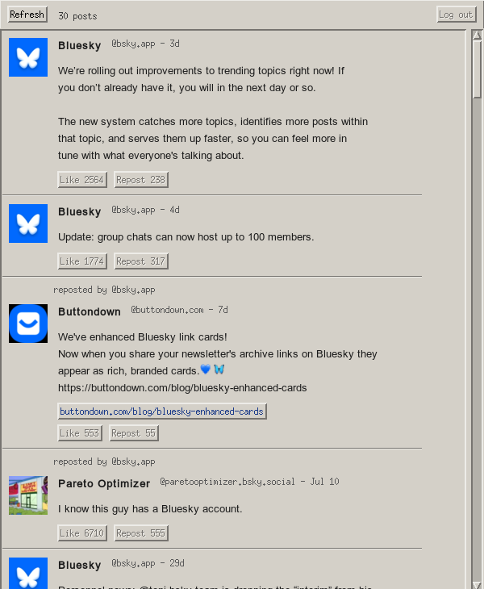
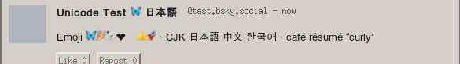

# BskyMotif

A [Bluesky](https://bsky.app) client for macOS built on the **OSF/Motif** X11
widget toolkit — 1993's enterprise Unix look, driven from Rust, running on
XQuartz. It logs in with an app password, shows your home timeline with
avatars, full Unicode + color emoji, expands links, quotes reply parents, and
lets you like and repost.



Full Unicode and color emoji, drawn with Xft (openmotif can't render UTF-8 on
its own):



## Why Motif

The brief was "as close to native as possible on macOS… write it in Swift or
Rust." Motif isn't native to macOS in the Cocoa sense — but the toolkit is real,
the C API is the genuine article, and XQuartz renders it as actual native macOS
windows (rootless mode). So the widgets are authentic Motif; the windows,
compositing, and window management are macOS. Rust drives the whole thing
through a handwritten FFI layer over libXm/libXt/libX11.

## Architecture

```
                    ┌──────────────────────────────────────────┐
                    │  Xt main thread (owns all widget calls)   │
   XQuartz  ◄──────►│  XtAppMainLoop                            │
   (:0, native      │    ├─ login form / timeline widgets       │
    macOS windows)  │    ├─ XtAppAddInput  ◄── self-pipe ──┐    │
                    │    └─ XtAppAddTimeOut (60s poll)      │    │
                    └───────────────────────────────────────┼───┘
                                                            │ ui_post(closure)
   ┌────────────────────────────────────────────────────────┼──┐
   │  worker std::threads (network, never touch widgets)     │  │
   │    login / getTimeline / like / repost / avatar fetch  ─┘  │
   │                        │                                    │
   │                        ▼                                    │
   │            bsky.social XRPC  +  cdn.bsky.app (avatars)      │
   └────────────────────────────────────────────────────────────┘
```

Xt is single-threaded and owns every widget call. Network work runs on plain
`std::thread`s; each hands its result back to the main thread by pushing a
closure onto a queue and writing one byte to a self-pipe that `XtAppAddInput`
watches. No widget is ever touched off the main thread.

| File | Responsibility |
|------|----------------|
| `src/bsky.rs` | XRPC client — auth, timeline, like/repost, link facets, ISO 8601 |
| `src/keychain.rs` | Session storage — macOS Keychain, or a file store off macOS |
| `src/motif.rs` | Handwritten Xt/Xm/Xlib/Xft FFI + helpers (Arg lists, XmStrings, pixmaps) |
| `src/text.rs` | Xft text→pixmap renderer with font fallback + color emoji |
| `src/ui.rs` | Widget construction: login form, post rows, avatar pixmaps |
| `src/main.rs` | App state, Xt callbacks, thread↔main-loop marshalling |

## Building

Prerequisites (Apple Silicon, Homebrew):

```sh
brew install --cask xquartz     # the X server (needs a password once)
brew install openmotif          # libXm 2.3.8; pulls libXt/libX11 as deps
```

Then:

```sh
cargo build --release           # binary at target/release/bsky-motif
cargo test                      # unit tests (mock HTTP server, no network)
```

Package the double-clickable app:

```sh
bash packaging/build-app.sh                 # dist/BskyMotif.app (ad-hoc signed)
bash packaging/sign-app.sh dist/BskyMotif.app   # re-sign with your Developer ID
open dist/BskyMotif.app
```

The binary is the bundle's main executable (`Contents/MacOS/BskyMotif`) — no
launcher script. On startup it points fontconfig at the bundled config, probes
the X display, and cold-starts XQuartz on `:0` if nothing is answering (with a
friendly alert if XQuartz isn't installed).

`sign-app.sh` signs inside-out with a Developer ID (auto-detected, or
`SIGN_IDENTITY=...`), hardened runtime + secure timestamp. To notarize + staple,
set up a [notarytool profile](https://developer.apple.com/documentation/security/customizing-the-notarization-workflow)
and pass it: `NOTARY_PROFILE=<name> bash packaging/sign-app.sh dist/BskyMotif.app`.

## Running from the terminal

```sh
DISPLAY=:0 ./target/release/bsky-motif
```

On first run you'll get a login form. Create an app password at **bsky.app →
Settings → Privacy & Security → App Passwords** (revocable anytime) — never use
your account password. The session is stored in the macOS Keychain and resumes
silently on subsequent launches; refresh-token expiry re-logs in automatically
from the stored app password.

### Environment overrides

| Variable | Effect |
|----------|--------|
| `BSKY_PUBLIC_FEED=<handle>` | Skip login; show a public author feed unauthenticated (used for UI testing) |
| `BSKY_SERVICE=<url>` | Point at a different PDS (default `https://bsky.social`) |
| `BSKY_OPEN_CMD=<cmd>` | Command used to open links (default `open` on macOS, `xdg-open` elsewhere) |
| `BSKY_NO_KEYCHAIN=1` | Skip the Keychain entirely (avoids the "different binary" access prompt during dev rebuilds) |

## Features

- **Home timeline** with author, handle, relative time, and full post text.
- **Full Unicode + color emoji.** openmotif 2.3.8 can't render UTF-8 through its
  own string path (it draws raw bytes 8-bit), so Unicode-bearing text — post
  bodies, display names, quoted parents — is drawn directly with Xft into X
  pixmaps, with two-font fallback (a broad Unicode face → a color-emoji face).
  CJK, accents, smart punctuation, and color emoji all render. See `text.rs`.
- **Avatars** — WebP/JPEG/PNG decoded, scaled, composited over the Motif gray,
  and pushed as X pixmaps. Fetched on background threads, applied when ready.
- **Links** — Bluesky shortens URLs in post text; the full target is recovered
  from the richtext link facet (byte-offset splicing, multibyte-safe) and shown
  both inline and as a clickable button that opens your browser.
- **Threading** — replies quote the parent post inline (author, time, text).
- **Like / repost** — authenticated `createRecord`/`deleteRecord`, toggling the
  button label and count with optimistic UI.
- **Refresh**, **load older** (cursor paging), and a **60s poll** that flags
  "new posts available."

## Portability

- **Self-contained bundle.** `packaging/build-app.sh` vendors the whole Homebrew
  dylib closure into `Contents/Frameworks` and rewrites install names to
  `@executable_path`, so `BskyMotif.app` runs on any Mac with XQuartz — no
  Homebrew required. (XQuartz's X *server* is still needed; these are the client
  libs.) A bundled fontconfig config points the vendored libfontconfig at the
  macOS system fonts.
- **Builds on Linux.** `build.rs` uses pkg-config + system lib dirs off macOS;
  links open via `xdg-open`. Needs `libmotif-dev libxt-dev libx11-dev
  libxft-dev` (Debian/Ubuntu names). On Linux with a native X server it runs
  directly — no XQuartz. Font quality depends on installed fonts (e.g.
  `fonts-noto-cjk`, `fonts-noto-color-emoji`).
- **Secrets** go through the [`keyring`](https://docs.rs/keyring) crate: the
  macOS Keychain, or the freedesktop **Secret Service** over D-Bus on Linux
  (GNOME Keyring / KWallet, via pure-Rust zbus — no `libdbus` needed). With no
  secret service running, the session simply isn't persisted (re-login each
  launch) — nothing is written in the clear.

## Known limitations / upgrade paths

- **Char-count word wrap** against a proportional font, tuned to fit — not
  measured with `XmStringWidth`/Xft extents. Long lines are close, not
  pixel-perfect.
- **No compose/reply/thread-view** — read + like/repost only, by scope.
